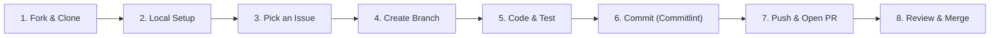

# Contributor Onboarding Walkthrough: From Clone to First Merged PR

Welcome to **Stellar Footprint Service** (`stellar-footprint-engine`)! Whether this is your very first open-source contribution or your hundredth, this step-by-step guide will walk you through setting up your local environment, picking an issue, writing and testing your changes, and getting your first pull request merged.

---

## Contributor Journey at a Glance



---

## Step 1: Fork and Clone the Repository

1. Click **Fork** on [Mossad-esc/stellar-footprint-engine](https://github.com/Mossad-esc/stellar-footprint-engine) to create your personal copy on GitHub.
2. Clone your fork locally and enter the project directory:

   ```bash
   git clone https://github.com/<your-username>/stellar-footprint-engine.git
   cd stellar-footprint-engine
   ```

3. Add the original repository as the `upstream` remote so you can keep your fork in sync:

   ```bash
   git remote add upstream https://github.com/Mossad-esc/stellar-footprint-engine.git
   git fetch upstream
   ```

---

## Step 2: Local Environment Setup

### Prerequisites

- **Node.js >= 22.12.0** (we recommend managing Node versions with [nvm](https://github.com/nvm-sh/nvm))
- **pnpm** (preferred) or **npm**
- **Git**
- **Docker & Docker Compose** (optional, only needed if you want to run Redis-backed integration tests locally)

### Setup Commands

1. Switch to the project's Node.js version (if using `nvm`):

   ```bash
   nvm use
   ```

2. Install dependencies:

   ```bash
   pnpm install
   ```

3. Create your local `.env` file from the template:

   ```bash
   cp .env.example .env
   ```

   Open `.env` and verify the default Stellar Testnet RPC settings (`STELLAR_RPC_URL`, `NETWORK_PASSPHRASE`). The default values work out of the box for local development and unit tests.

4. Verify your setup by building the project and starting the dev server:

   ```bash
   pnpm run build
   pnpm run dev
   ```

   You should see the server listening on `http://localhost:3000`.

---

## Step 3: Pick a Good First Issue

Looking for a place to start?

1. Browse open GitHub issues with the **`good first issue`** or **`documentation`** label.
2. Check [ISSUES.md](../../ISSUES.md) for curated starter ideas across API endpoints, docs, tests, and developer experience.
3. Leave a short comment on the issue (e.g., *"I'd like to work on this!"*) so maintainers and other contributors know it's claimed.

---

## Step 4: Branch Naming Conventions

Always create a new branch from an up-to-date `main` before making changes:

```bash
git checkout main
git pull upstream main
git checkout -b <prefix>/<short-description>
```

Husky's pre-commit hook validates branch names automatically. Your branch **must** start with one of these prefixes:

| Prefix | When to Use | Example |
|---|---|---|
| `feature/` | New functionality or endpoints | `feature/batch-dry-run` |
| `fix/` | Bug fixes | `fix/cache-ttl-parsing` |
| `docs/` | Documentation and guides | `docs/onboarding-guide` |
| `refactor/` | Code restructuring without behavior change | `refactor/fee-estimator` |
| `chore/` | Maintenance, dependencies, tooling | `chore/update-eslint` |
| `hotfix/` | Urgent production fixes | `hotfix/rpc-timeout` |
| `release/` | Release preparation | `release/v1.4.0` |

> [!TIP]
> Never commit directly to `main`, `develop`, or `live`. Husky's pre-push hook blocks direct pushes to protected branches.

---

## Step 5: Run Tests and Quality Checks Locally

Unit tests mock the Stellar RPC so they run fast and offline without external dependencies.

### Run the Full Unit Test Suite

```bash
pnpm test
```

### Run a Single Test File (Recommended During Development)

```bash
pnpm test -- src/i18n/__tests__/i18n.test.ts
```

### Run Tests with Coverage

```bash
pnpm run test:coverage
```

CI enforces minimum coverage thresholds (`85%` branches, `90%` functions, `90%` lines, `90%` statements).

### Run Integration Tests (Requires Redis)

```bash
docker compose -f docker-compose.test.yml up -d
pnpm test:integration
docker compose -f docker-compose.test.yml down
```

### Linting, Formatting, and Type Checking

Run these before committing to avoid surprises from Husky hooks or CI:

```bash
pnpm run lint
pnpm run format:check
pnpm run typecheck
```

If formatting or lint issues are reported, you can auto-fix most of them with:

```bash
pnpm run lint:fix
pnpm run format
```

---

## Step 6: Commit Message Formatting (Commitlint)

This repository uses [Conventional Commits](https://www.conventionalcommits.org/) enforced by `commitlint` (`commitlint.config.js`) on every commit.

### Format

```text
<type>(<scope>): <short imperative description>

[optional body explaining why]

[optional footer — e.g. Closes #132]
```

### Allowed Types

- `feat` — New feature
- `fix` — Bug fix
- `docs` — Documentation only
- `style` — Code formatting (no logic change)
- `refactor` — Code restructure (no behavior change)
- `test` — Adding or updating tests
- `chore` — Maintenance or dependency updates

### Allowed Scopes (`commitlint.config.js`)

Every commit **must** include one of these scopes:

| Scope | Area |
|---|---|
| `api` | API endpoints, routes, and controllers |
| `services` | Business logic and service layer |
| `middleware` | Express middleware (auth, logging, caching, rate limiting) |
| `config` | Configuration and environment setup |
| `utils` | Utility functions and helpers |
| `docs` | Documentation, ADRs, and guides |
| `infra` | Infrastructure, Docker, Kubernetes, CI |
| `tests` | Test suite and test fixtures |
| `dx` | Developer experience (tooling, build, linting) |

### Examples

```text
docs(docs): add contributor onboarding walkthrough
feat(api): add French error localization
fix(services): handle missing TTL metadata gracefully
test(tests): add key parity assertions for i18n locales
```

### Rules to Remember

- Use **present imperative tense**: `"add"` instead of `"added"` or `"adds"`.
- Keep the subject line **under 72 characters**.
- Link the issue in the footer when applicable: `Closes #132`.

---

## Step 7: Push and Submit Your Pull Request

1. Rebase onto the latest `upstream/main` to avoid merge conflicts:

   ```bash
   git fetch upstream
   git rebase upstream/main
   ```

2. Push your branch to your fork:

   ```bash
   git push -u origin <your-branch-name>
   ```

   Note that Husky's pre-push hook runs `pnpm run typecheck` and fast unit tests automatically.

3. Open a Pull Request on GitHub targeting `Mossad-esc/stellar-footprint-engine:main`.

### PR Submission Etiquette

- **Use a Conventional Commit title** for the PR (e.g., `docs(docs): add contributor onboarding guide`).
- **Explain the "why"**, not just the "what", in the PR description.
- **Reference the issue** (`Closes #<issue-number>`).
- **Keep PRs focused**: one logical change or issue per PR makes reviews much faster.
- **Respond to feedback in the same branch**: push new commits rather than opening a second PR.

### PR Readiness Checklist

Before requesting a review, verify every item below:

- [ ] Branch name uses an allowed prefix (`feature/`, `fix/`, `docs/`, etc.).
- [ ] All commit messages pass `commitlint` (`type(scope): description`).
- [ ] `pnpm run lint`, `pnpm run format:check`, and `pnpm run typecheck` pass with zero errors.
- [ ] Relevant unit tests pass (`pnpm test`) and new behavior is covered by tests.
- [ ] Documentation or OpenAPI specs are updated if API behavior changed.
- [ ] PR description clearly summarizes changes and includes `Closes #<issue>`.

---

## Troubleshooting Common Local Setup Issues

### 1. Node.js Version Mismatch

**Symptom:** `pnpm install` or `pnpm test` fails with syntax errors, engine warnings, or unsupported Node APIs.

**Solution:**
Check your active Node version:

```bash
node -v
```

This project requires **Node.js >= 22.12.0**. Install and activate it with `nvm`:

```bash
nvm install 22
nvm use 22
```

If `nvm` is not installed, download Node 22 LTS from [nodejs.org](https://nodejs.org/).

### 2. Redis Connection Errors (`ECONNREFUSED 127.0.0.1:6379`)

**Symptom:** Integration tests or local caching throw `ECONNREFUSED` when connecting to Redis.

**Solution:**
- **Running integration tests:** Start the test Redis container first:
  ```bash
  docker compose -f docker-compose.test.yml up -d
  ```
- **Running unit tests or local dev without Redis:** Make sure `REDIS_URL` is unset or commented out in your `.env` file. The service automatically falls back to the in-memory LRU cache when Redis is not configured.

### 3. Docker Permission Issues (`permission denied while trying to connect to the Docker daemon socket`)

**Symptom:** Running `docker compose -f docker-compose.test.yml up -d` fails on Linux with a socket permission error.

**Solution:**
1. Ensure the Docker daemon is running:
   ```bash
   sudo systemctl start docker
   ```
2. Add your user to the `docker` group and reload your group membership:
   ```bash
   sudo usermod -aG docker $USER
   newgrp docker
   ```
3. Verify with `docker ps`. (You may need to log out and back in if `newgrp` doesn't persist across new terminal tabs.)

---

## Need Help?

- Review the full [CONTRIBUTING.md](../../CONTRIBUTING.md) for detailed testing, mutation testing, and snapshot guidelines.
- Explore [docs/architecture.md](../architecture.md) to understand how requests flow through the service.
- Ask questions in your issue or PR thread — maintainers are happy to help!
