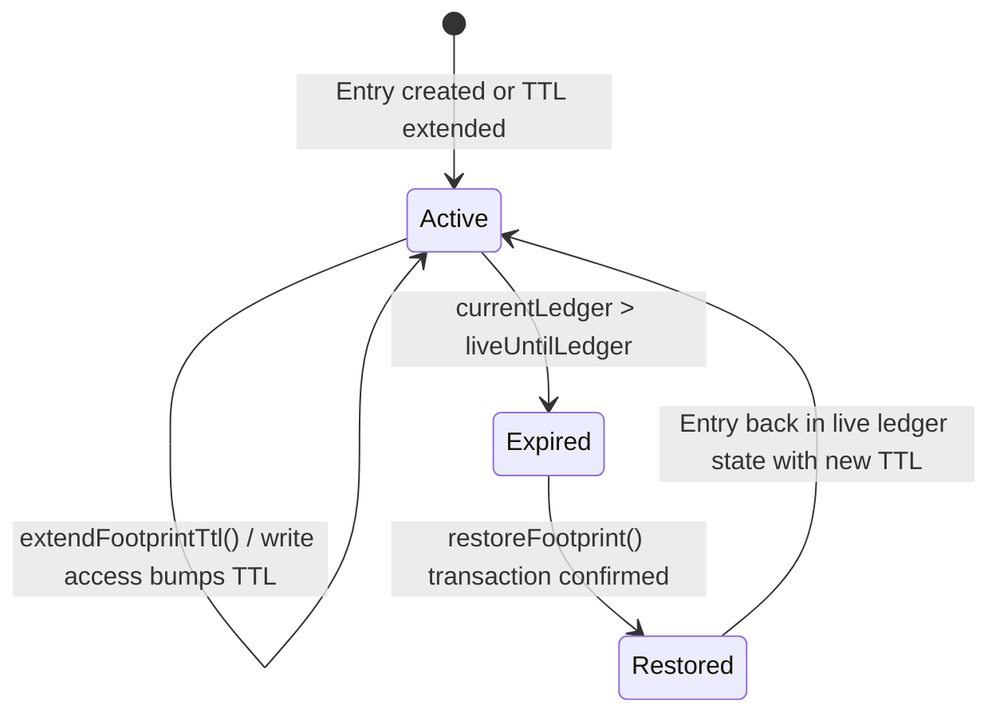
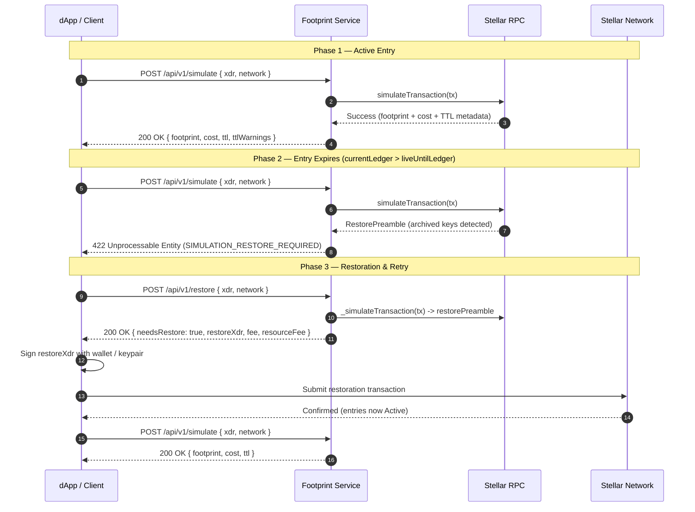

# Soroban State Archival & Restoration Lifecycle Guide

Soroban's **State Archival** system prevents unbounded ledger bloat by giving every contract and contract data entry a finite **Time-To-Live (TTL)**. Understanding how TTLs, rent, expiration, and restoration work is essential for building reliable Soroban dApps.

This guide explains the full lifecycle (`Active -> Expired -> Restored`) and shows how to use the Stellar Footprint Service (`POST /api/v1/simulate` and `POST /api/v1/restore`) to detect and recover archived ledger entries.

---

## Table of Contents

1. [Why State Archival Exists](#why-state-archival-exists)
2. [Storage Types & Archival Behavior](#storage-types--archival-behavior)
3. [The State Archival Lifecycle](#the-state-archival-lifecycle)
4. [TTL Metadata in `/api/v1/simulate`](#ttl-metadata-in-apiv1simulate)
5. [Detecting `LEDGER_ENTRY_RESTORATION_REQUIRED`](#detecting-ledger_entry_restoration_required)
6. [Step-by-Step: Constructing & Submitting a Restoration Transaction](#step-by-step-constructing--submitting-a-restoration-transaction)
7. [Extending TTLs Proactively](#extending-ttls-proactively)
8. [Best Practices](#best-practices)

---

## Why State Archival Exists

Every ledger entry stored on Stellar consumes validator RAM and disk. Without expiration, abandoned smart contracts and stale user balances would remain in active validator state forever.

Soroban solves this with **State Archival**:

- Every Soroban ledger entry has a **`liveUntilLedger`** sequence number stored in a paired `TTL` ledger entry.
- Keeping an entry alive requires paying **state rent** (computed from entry size, storage type, and the number of ledgers extended).
- When `currentLedger > liveUntilLedger`, the entry expires.

---

## Storage Types & Archival Behavior

Soroban has three contract storage types, each with different archival rules:

| Storage Type | Typical Use Case | Max TTL Extension | When TTL Expires | Restorable? |
|---|---|---|---|---|
| **Temporary** | Short-lived nonces, oracle quotes, session data | Shorter max TTL | **Permanently deleted** from the ledger | No |
| **Persistent** | Token balances, user positions, voting records | Long max TTL (up to ~1 year) | **Archived** (evicted from active state) | Yes (`restoreFootprint`) |
| **Instance** | Contract config, admin address, compiled WASM code | Tied to contract instance | **Archived** along with contract code | Yes (`restoreFootprint`) |

> **Important:** A contract's **WASM bytecode (`ContractCode`)** and **contract instance (`ContractData` with `Instance` durability)** are both persistent. If either expires, *every* call to that contract will fail simulation until it is restored.

---

## The State Archival Lifecycle

A persistent or instance ledger entry moves through three states: **Active**, **Expired (Archived)**, and **Restored**.



### End-to-End Flow with the Footprint Service



---

## TTL Metadata in `/api/v1/simulate`

Every simulation response from `POST /api/v1/simulate` includes TTL inspection fields so your application can warn users *before* entries expire:

| Field | Description |
|---|---|
| `ttl` | Map keyed by base64 `LedgerKey` XDR containing `liveUntilLedger`, `expiresInLedgers`, and `requiresRestore`. |
| `ttlWarnings` | Human-readable warnings for entries below `TTL_WARNING_THRESHOLD_LEDGERS` (default: `240000` ledgers, ~14 days at ~5s/ledger). |
| `cost.ttlExtension` | Recommends a relative `extendTo` ledger count when entries fall below `TTL_EXTENSION_SAFETY_LEDGERS` (default: `100000` ledgers) and sets `restoreFirst: true` if any entry is already archived. |

When an entry is archived, `requiresRestore` is `true` and `expiresInLedgers` is negative (or derived from the restoration preamble).

---

## Detecting `LEDGER_ENTRY_RESTORATION_REQUIRED`

When you call `POST /api/v1/simulate` on a transaction that touches an archived entry, the service returns **HTTP `422 Unprocessable Entity`** with:

- `error`: `"Transaction requires ledger entry restoration before simulation."` (defined in `ERROR_MESSAGES.LEDGER_ENTRY_RESTORATION_REQUIRED`)
- `code`: `"SIMULATION_RESTORE_REQUIRED"`
- `type`: `"restoration_required"`
- `ttl`, `ttlWarnings`, and `cost.ttlExtension` (`restoreFirst: true`)

```json
{
  "success": false,
  "type": "restoration_required",
  "error": "Transaction requires ledger entry restoration before simulation.",
  "code": "SIMULATION_RESTORE_REQUIRED",
  "ttl": {
    "AAAABgAAAA...": {
      "liveUntilLedger": 1200000,
      "expiresInLedgers": -450,
      "requiresRestore": true
    }
  },
  "ttlWarnings": [
    "Footprint entry AAAABgAAAA... is archived; restore it before extending its TTL."
  ],
  "cost": {
    "cpuInsns": "0",
    "memBytes": "0",
    "ttlExtension": {
      "recommended": true,
      "restoreFirst": true
    }
  }
}
```

### Detecting It in Client Code

Check for HTTP `422` together with either `data.code === "SIMULATION_RESTORE_REQUIRED"`, `data.type === "restoration_required"`, or `data.error === "Transaction requires ledger entry restoration before simulation."`:

```typescript
const simRes = await fetch("http://localhost:3000/api/v1/simulate", {
  method: "POST",
  headers: { "Content-Type": "application/json" },
  body: JSON.stringify({ xdr: txXdr, network: "testnet" }),
});

const simData = await simRes.json();

const needsRestoration =
  simRes.status === 422 &&
  (simData.code === "SIMULATION_RESTORE_REQUIRED" ||
    simData.type === "restoration_required" ||
    simData.error ===
      "Transaction requires ledger entry restoration before simulation.");
```

---

## Step-by-Step: Constructing & Submitting a Restoration Transaction

### Step 1 — Request a Restoration Transaction from `/api/v1/restore`

Send the **same unsigned transaction XDR** to `POST /api/v1/restore`. Internally, the service calls Soroban RPC, extracts `restorePreamble` (which contains the exact archived `readWrite` ledger keys and rent `minResourceFee`), fetches the source account's latest sequence number, and builds a `RestoreFootprint` transaction.

```typescript
const restoreRes = await fetch("http://localhost:3000/api/v1/restore", {
  method: "POST",
  headers: { "Content-Type": "application/json" },
  body: JSON.stringify({ xdr: txXdr, network: "testnet" }),
});

const { success, data } = await restoreRes.json();
// data: { needsRestore: boolean, restoreXdr?: string, fee?: string, resourceFee?: string }
```

### Step 2 — Sign and Submit `restoreXdr`

If `data.needsRestore` is `true`, decode `data.restoreXdr`, sign it with the user's wallet (e.g., Freighter) or keypair, and submit it to Stellar RPC:

```typescript
import * as StellarSdk from "@stellar/stellar-sdk";

if (data.needsRestore && data.restoreXdr) {
  const networkPassphrase = StellarSdk.Networks.TESTNET;
  const server = new StellarSdk.rpc.Server("https://soroban-testnet.stellar.org");

  // Option A: Sign with a Keypair (backend / CLI)
  const restoreTx = StellarSdk.TransactionBuilder.fromXDR(
    data.restoreXdr,
    networkPassphrase,
  );
  restoreTx.sign(keypair);

  // Option B: Sign with Freighter in a browser dApp
  // const signedXdr = await signTransaction(data.restoreXdr, { networkPassphrase });
  // const restoreTx = StellarSdk.TransactionBuilder.fromXDR(signedXdr, networkPassphrase);

  const sendResult = await server.sendTransaction(restoreTx);

  // Poll until the restoration ledger closes
  let txStatus = await server.getTransaction(sendResult.hash);
  while (txStatus.status === "NOT_FOUND") {
    await new Promise((r) => setTimeout(r, 1500));
    txStatus = await server.getTransaction(sendResult.hash);
  }

  if (txStatus.status !== "SUCCESS") {
    throw new Error(`Restoration transaction failed: ${txStatus.status}`);
  }
}
```

### Step 3 — Rebuild (If Sequence Changed) & Re-Simulate

Because submitting the restoration transaction consumed the source account's sequence number, **rebuild your original transaction** with the updated account sequence number before calling `POST /api/v1/simulate` again:

```typescript
// Fetch updated sequence number and rebuild the original invocation tx
const updatedAccount = await server.getAccount(publicKey);
const rebuiltTx = new StellarSdk.TransactionBuilder(updatedAccount, {
  fee: StellarSdk.BASE_FEE,
  networkPassphrase,
})
  .addOperation(contract.call("your_method", ...args))
  .setTimeout(30)
  .build();

// Re-simulate — now returns 200 OK with footprint & cost
const retryRes = await fetch("http://localhost:3000/api/v1/simulate", {
  method: "POST",
  headers: { "Content-Type": "application/json" },
  body: JSON.stringify({ xdr: rebuiltTx.toXDR(), network: "testnet" }),
});
```

### How Restoration Works Under the Hood

If you need to inspect or construct a restoration transaction manually using `@stellar/stellar-sdk`:

1. A restoration transaction uses `Operation.restoreFootprint({})`.
2. The `SorobanTransactionData` attached via `.setSorobanData(...)` places all archived `LedgerKey`s in `resources.footprint.readWrite` (never `readOnly`) and sets `resourceFee` to at least `restorePreamble.minResourceFee`.
3. `POST /api/v1/estimate-fee` also supports `operationType: "restore"` so you can preview restoration rent costs before building the transaction.

---

## Extending TTLs Proactively

Restoring an archived entry is more expensive than extending an active entry's TTL before it expires. When `ttlWarnings` or `cost.ttlExtension.recommended` is `true` (and `restoreFirst` is `false`), you can extend TTLs using `Operation.extendFootprintTtl({ extendTo })` with the target keys placed in `readOnly`.

You can estimate the extension fee ahead of time with `POST /api/v1/estimate-fee`:

```json
{
  "operationType": "extend",
  "extendTo": 200000,
  "footprint": {
    "readOnly": ["AAAABgAAAA..."],
    "readWrite": []
  },
  "network": "testnet"
}
```

---

## Best Practices

1. **Always handle `SIMULATION_RESTORE_REQUIRED` (`422`) in your UI** — Prompt the user with a clear two-step flow: *"Some contract state has expired and must be restored before your transaction can run."*
2. **Refresh the account sequence number after restoration** — Submitting `restoreXdr` increments the source account's sequence number by `1`. Always rebuild the original transaction before re-simulating.
3. **Monitor `ttlWarnings` in production** — For critical contract WASM and instance entries, run a periodic job that checks TTLs and submits `extendFootprintTtl` before `liveUntilLedger` is reached.
4. **Budget for rent** — Restoration fees depend on entry size (e.g., compiled WASM size) and network rent rates. Use `data.fee` and `data.resourceFee` from `/api/v1/restore` to display accurate costs to users.

---

## Related Documentation

- [Error Handling Guide](./error-handling.md)
- [Understanding Soroban Footprints](./understanding-footprints.md)
- [Freighter Wallet Integration Guide](./wallet-integration.md)
- [Next.js dApp Integration Tutorial](../tutorials/nextjs-dapp-integration.md)
